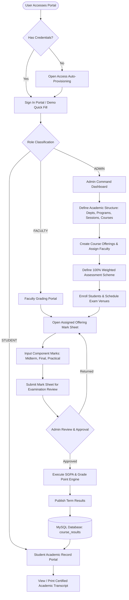

# SOFTWARE PROJECT REPORT

**B.Tech 2nd Year – Computer Science and Engineering (Data Science)**  
**Academic Session:** 2026–2027  
**Project Title:** UniGrade — University Examination & Grading Management System  
**Submitted by:** Srinjoyee Goswami (Roll No.: CS2026001 / Reg No.: UG2026CS001)  
**Department:** Department of Computer Science and Engineering (Data Science)  
**Institution:** [College / Institute Name]  

---

## TABLE OF CONTENTS

1. [Abstract](#chapter-1-abstract)
2. [Introduction](#chapter-2-introduction)
3. [Problem Statement](#chapter-3-problem-statement)
4. [Objectives of the Project](#chapter-4-objectives-of-the-project)
5. [Scope of the Project](#chapter-5-scope-of-the-project)
6. [Tools and Technologies Used](#chapter-6-tools-and-technologies-used)
7. [System Requirements](#chapter-7-system-requirements)
8. [System Design](#chapter-8-system-design)
   - 8.1 Application Workflow
   - 8.2 Main Modules
   - 8.3 User Interface Design & Architecture
9. [Database Design](#chapter-9-database-design)
   - 9.1 Database Name
   - 9.2 Table Structures & Schema Definitions
   - 9.3 Database Operations (CRUD)
10. [Implementation](#chapter-10-implementation)
    - 10.1 Architecture Overview
    - 10.2 Frontend Implementation
    - 10.3 Backend REST API & Database Connectivity
    - 10.4 Core Algorithmic Snippets (SGPA & Grade Point Engine)
11. [Testing](#chapter-11-testing)
12. [Results and Screenshots](#chapter-12-results-and-screenshots)
13. [Limitations](#chapter-13-limitations)
14. [Future Scope](#chapter-14-future-scope)
15. [Conclusion](#chapter-15-conclusion)
16. [References](#chapter-16-references)
- [Appendix](#appendix)

---

## CHAPTER 1: ABSTRACT

UniGrade is a full-stack, centralized University Examination and Grading Management Web Application engineered to replace error-prone manual spreadsheets and fragmented departmental grading practices. Built using modern web technologies—a high-performance React 18 single-page application (SPA) styled with a strict monochromatic Swiss design language, coupled with a robust PHP 8.3 REST API and MySQL 8.0 relational database—UniGrade automates the end-to-end examination lifecycle. Key functionalities include university-wide academic hierarchy modeling (Departments, Programs, Academic Sessions, and Courses), section-wise Course Offerings, multi-component weighted assessment schemes (e.g., 30% Mid-Term + 50% Final Examination + 20% Lab Practical), secure mark-sheet workflows with approval controls, credit-weighted SGPA/CGPA evaluation engines following UGC 10-point scale standards, and automated provisional grade sheet and transcript generation. The application eliminates manual computation errors, accelerates examination result declaration cycles from weeks to minutes, enforces strict role-based access control (RBAC) across Administrators, Faculty, and Students, and ensures auditable integrity of all institutional academic records.

---

## CHAPTER 2: INTRODUCTION

### 2.1 Background of the Project
Higher educational institutions evaluate thousands of students across diverse degree programs, academic sessions, and semesters every term. Traditionally, exam scheduling, continuous assessment marks collation, final theoretical paper grading, and SGPA calculations were handled through standalone spreadsheets or paper records. This fragmented approach frequently introduced data inconsistencies, computation discrepancies, delayed result publications, and elevated administrative burdens on examination cells.

### 2.2 Why This Project is Needed
Modern university governance requires transparent, auditable, and instant academic record processing. UniGrade fulfills this necessity by establishing a single source of truth for all curriculum definitions, faculty offerings, examination schedules, mark entry validations, and grade declarations.

### 2.3 How the Application Works
UniGrade operates on a client-server REST architecture:
1. **Administrative Setup:** The Examination Cell configures departments, degree programs, sessions, courses, and active course offerings.
2. **Evaluation Configuration:** Weighted assessment components (Midterm, Final, Practical, Quizzes) totalling 100% are defined for each subject.
3. **Enrollment & Scheduling:** Students are enrolled into specific course sections, and examination schedules with dates and venues are generated.
4. **Marks Entry & Review:** Faculty enter component scores with real-time range validation, submit marks for review, and administrators verify and lock submissions.
5. **Grading & Publication:** The calculation engine evaluates total percentages against UGC grade bands (O, A+, A, B+, B, C, F), computes credit-weighted grade points, and publishes official transcripts accessible to students in real time.

### 2.4 Intended Users
- **System Administrators / Exam Controllers:** Full administrative control over departments, courses, faculty, students, approval workflows, and publication.
- **Faculty Members:** View assigned course offerings, input and modify continuous assessment and exam scores, submit mark sheets, and inspect class performance.
- **Students:** View enrolled courses, check examination dates and assigned venues, and access certified term-end results and academic transcripts.

---

## CHAPTER 3: PROBLEM STATEMENT

In conventional university workflows, examination management is impeded by multiple critical pain points:
1. **Manual Calculation Errors:** Hand-computed or spreadsheet-derived percentages, grade conversions, and credit-weighted grade point averages (SGPA/CGPA) are susceptible to human error.
2. **Lack of Auditability and Version Control:** Changes made to student marks lack timestamped tracking, making post-exam dispute resolution cumbersome.
3. **Data Redundancy and Inconsistencies:** Course offerings and student lists duplicated across departments lead to broken records and orphaned marks.
4. **Delayed Result Declarations:** Manual collation of practical, internal, and external theory marks consumes weeks of administrative effort.
5. **Inefficient Communication:** Students must physically visit departments or wait for manual notice boards to verify grades and exam venue allocations.

UniGrade resolves these deficiencies by providing a centralized database, strict relational integrity constraints, automated formula computation engines, and transparent real-time portals.

---

## CHAPTER 4: OBJECTIVES OF THE PROJECT

The primary objectives achieved by the UniGrade system are:
1. To engineer an intuitive, accessible, and responsive user interface adhering to monochromatic, professional typographical hierarchy.
2. To automate weighted multi-component score calculations and UGC 10-point credit-weighted SGPA computation:
   $$\text{SGPA} = \frac{\sum (\text{Course Credits} \times \text{Grade Point})}{\sum \text{Course Credits}}$$
3. To eliminate manual mark errors through client- and server-side range validation and mandatory submission approvals.
4. To implement 3-tier Role-Based Access Control (Admin, Faculty, Student) protecting sensitive academic evaluation data.
5. To provide instant querying and export capabilities for exam schedules, mark sheets, and academic transcripts.
6. To design a normalized MySQL database schema with cascaded foreign keys guaranteeing relational integrity.

---

## CHAPTER 5: SCOPE OF THE PROJECT

### 5.1 System Functionalities
- **Authentication & Open Access:** Fast-session JWT/session cookie authentication with demo logins and role-specific dashboard routing.
- **Academic Hierarchy Management:** CRUD operations for Departments, Degree Programs, Academic Sessions, and Courses.
- **Course Offering Engine:** Assigning subjects to faculty, academic sessions, and semesters with section capacities.
- **Student Enrollment:** Batch-enrollment and single-student enrollment by academic program.
- **Weighted Assessment Management:** Customizable evaluation schemes ensuring components total exactly 100%.
- **Examination Timetable & Venue Allocations:** Exam date, timing, and room assignments.
- **Marks Entry & Mark Sheet Submissions:** Draft saving, range checking (0 to Max Marks), submission locks, and admin review approval.
- **Grading & Result Publication:** Batch calculation of percentages, letter grades, and grade points, followed by administrative publication.
- **Student Academic Transcript:** Verified view of published grades, credits earned, and SGPA calculations.

### 5.2 Beneficiary Groups
- **University Examination Cell:** Reduced operational turnaround time and zero manual grade re-calculations.
- **Academic Departments & Faculty:** Streamlined score submission workflows without paper record friction.
- **Enrolled Students:** Transparent, instant access to certified grade cards and exam details.

---

## CHAPTER 6: TOOLS AND TECHNOLOGIES USED

| Technology | Category | Purpose in Project |
| :--- | :--- | :--- |
| **React.js 18** | Frontend Framework | Building declarative, component-driven reactive single-page user interfaces |
| **Vite 5** | Frontend Build Tool | High-speed Hot Module Replacement (HMR) and optimized ES module bundling |
| **CSS3 & Swiss Design** | UI & Styling | Custom CSS, monochromatic palette (`#171717`, `#F4F4F1`, `#FFFFFF`), accessible typography |
| **Lucide React** | UI Icons | Lightweight SVG iconography for navigation and status feedback |
| **PHP 8.3** | Backend Language | Processing business logic, REST API routing, input validation, and formula execution |
| **PDO (PHP Data Objects)** | Database Driver | Secure database communication utilizing prepared statements to prevent SQL Injection |
| **MySQL 8.0** | Relational Database | Storing normalized academic entities with strict foreign keys, indexes, and transactions |
| **Visual Studio Code** | IDE | Code authoring, syntax checking, Git source control, and debugging |
| **Google Chrome / Edge** | Web Browser | Runtime testing, DOM debugging, network payload profiling, and visual layout inspection |

---

## CHAPTER 7: SYSTEM REQUIREMENTS

### 7.1 Hardware Requirements
- **Processor:** Dual-Core x86_64 or ARM64 processor (Intel Core i3 / AMD Ryzen 3 or higher recommended).
- **RAM:** Minimum 4 GB RAM (8 GB recommended for concurrent Vite dev server and MySQL service).
- **Storage:** Minimum 500 MB free disk space for codebase, dependencies, and database storage.
- **Network Interface:** Local loopback interface (`localhost`) or standard LAN for intranet deployment.

### 7.2 Software Requirements
- **Operating System:** Windows 10/11, Ubuntu 22.04 LTS+, or macOS.
- **Backend Runtime:** PHP 8.2 or 8.3 with `pdo_mysql` and `mbstring` extensions enabled.
- **Database Server:** MySQL Server 8.0 or MariaDB 10.6+.
- **Frontend Runtime:** Node.js v18.x or v20.x with npm / pnpm package manager.
- **Web Browser:** Any modern evergreen browser (Google Chrome 110+, Mozilla Firefox 110+, Microsoft Edge).

---

## CHAPTER 8: SYSTEM DESIGN

### 8.1 Application Workflow



### 8.2 Main Modules
1. **Authentication & Authorization Module:** Enforces role-based gates (`ADMIN`, `FACULTY`, `STUDENT`) with rate-limiting protection.
2. **Department & Program Management Module:** Manages academic divisions and degree structures (e.g., B.Tech CSE, IT, AI&DS).
3. **Course Catalog & Offerings Module:** Configures subject credits, curriculum types (Theory/Practical), and assigns active semester offerings.
4. **Assessment & Examination Scheme Module:** Enforces exact 100% component weight reconciliation and venue/date scheduling.
5. **Student Enrollment Module:** Links enrolled students to specific course offering sections.
6. **Marks Entry & Review Module:** Real-time numerical mark entry with boundary enforcement and multi-state submission workflows (`DRAFT` $\to$ `SUBMITTED` $\to$ `APPROVED`).
7. **Grading & Calculation Engine Module:** Executes UGC standard conversion formulas to assign Letter Grades and Grade Points.
8. **Result Publication & Transcript Module:** Locks finalized grades, outputs performance distributions, and generates student transcripts.

### 8.3 User Interface Design Principles
The interface is designed with a **monochromatic Swiss aesthetic**:
- High-contrast, neutral color palette eliminating distracting neon/saturated colors.
- Clear typographic hierarchy with bold geometric sans-serif headers.
- Modular, border-delimited card containers with subtle 1px border lines (`#D8D8D4`).
- Real-time inline feedback through micro-badges (`ACTIVE`, `COMPLETED`, `MANDATORY`, `PUBLISHED`).

---

## CHAPTER 9: DATABASE DESIGN

### 9.1 Database Name
**Database:** `unigrade_db`  
**Character Set:** `utf8mb4` | **Collation:** `utf8mb4_unicode_ci`

### 9.2 Key Table Structures

#### 1. Table: `users`
| Field Name | Data Type | Key / Constraint | Description |
| :--- | :--- | :--- | :--- |
| `id` | INT | PRIMARY KEY, AUTO_INC | Unique identifier for each user |
| `full_name` | VARCHAR(255) | NOT NULL | User's complete legal name |
| `email` | VARCHAR(255) | UNIQUE, NOT NULL | Institutional or personal login email |
| `password_hash` | VARCHAR(255) | NOT NULL | Bcrypt cryptographic hash of password |
| `role` | ENUM | 'ADMIN','FACULTY','STUDENT' | Access tier authorization |
| `account_status`| ENUM | 'ACTIVE','INACTIVE','SUSPENDED' | Account availability status |

#### 2. Table: `departments`
| Field Name | Data Type | Key / Constraint | Description |
| :--- | :--- | :--- | :--- |
| `id` | INT | PRIMARY KEY, AUTO_INC | Department identifier |
| `department_name`| VARCHAR(255) | NOT NULL | e.g., Computer Science & Engineering |
| `department_code`| VARCHAR(20) | UNIQUE, NOT NULL | Short code (e.g., CSE, IT, AIDS) |
| `status` | ENUM | 'ACTIVE','INACTIVE' | Operational status |

#### 3. Table: `programs`
| Field Name | Data Type | Key / Constraint | Description |
| :--- | :--- | :--- | :--- |
| `id` | INT | PRIMARY KEY, AUTO_INC | Program identifier |
| `department_id` | INT | FK $\to$ `departments(id)` | Parent academic department |
| `program_name` | VARCHAR(255) | NOT NULL | e.g., B.Tech in CSE |
| `program_code` | VARCHAR(20) | UNIQUE, NOT NULL | Code (e.g., BTECH-CSE) |
| `duration_years`| TINYINT | NOT NULL DEFAULT 4 | Degree course length |

#### 4. Table: `courses`
| Field Name | Data Type | Key / Constraint | Description |
| :--- | :--- | :--- | :--- |
| `id` | INT | PRIMARY KEY, AUTO_INC | Course catalog identifier |
| `course_code` | VARCHAR(20) | UNIQUE, NOT NULL | Catalog code (e.g., CS101, CS102) |
| `course_title` | VARCHAR(255) | NOT NULL | e.g., Data Structures & Algorithms |
| `department_id` | INT | FK $\to$ `departments(id)` | Owning department |
| `credit_hours` | TINYINT | NOT NULL DEFAULT 4 | Subject academic credit weight |
| `course_type` | ENUM | 'THEORY','PRACTICAL','LAB'| Curriculum category |

#### 5. Table: `course_offerings`
| Field Name | Data Type | Key / Constraint | Description |
| :--- | :--- | :--- | :--- |
| `id` | INT | PRIMARY KEY, AUTO_INC | Course offering section instance |
| `course_id` | INT | FK $\to$ `courses(id)` | Associated subject catalog reference |
| `academic_session_id` | INT | FK $\to$ `academic_sessions(id)` | Academic term (e.g., 2026-2027) |
| `semester_number` | TINYINT | NOT NULL | Term semester index (1 to 8) |
| `section` | VARCHAR(10) | NOT NULL DEFAULT 'A' | Division/Section letter |
| `faculty_user_id` | INT | FK $\to$ `users(id)` | Assigned instructor |

#### 6. Table: `assessment_components`
| Field Name | Data Type | Key / Constraint | Description |
| :--- | :--- | :--- | :--- |
| `id` | INT | PRIMARY KEY, AUTO_INC | Component identifier |
| `offering_id` | INT | FK $\to$ `course_offerings(id)`| Course offering reference |
| `component_name`| VARCHAR(100) | NOT NULL | e.g., Mid-Semester Examination |
| `assessment_type`| ENUM | 'MIDTERM','FINAL','PRACTICAL'| Evaluation category |
| `maximum_marks` | DECIMAL(8,2) | NOT NULL | Maximum points (e.g., 50.00, 100.00) |
| `weight_percentage`| DECIMAL(5,2) | NOT NULL | Evaluation weight (e.g., 30.00, 50.00)|

#### 7. Table: `student_enrollments`
| Field Name | Data Type | Key / Constraint | Description |
| :--- | :--- | :--- | :--- |
| `id` | INT | PRIMARY KEY, AUTO_INC | Enrollment record ID |
| `offering_id` | INT | FK $\to$ `course_offerings(id)`| Enrolled subject offering |
| `student_user_id`| INT | FK $\to$ `users(id)` | Enrolled student reference |
| `status` | ENUM | 'ENROLLED','DROPPED' | Enrollment status |

#### 8. Table: `assessment_marks`
| Field Name | Data Type | Key / Constraint | Description |
| :--- | :--- | :--- | :--- |
| `id` | INT | PRIMARY KEY, AUTO_INC | Mark record ID |
| `assessment_component_id` | INT | FK $\to$ `assessment_components(id)` | Target component |
| `enrollment_id` | INT | FK $\to$ `student_enrollments(id)` | Enrolled student |
| `obtained_marks`| DECIMAL(8,2) | NULLABLE | Score awarded |
| `attendance_status` | ENUM | 'PRESENT','ABSENT' | Examination attendance |

#### 9. Table: `course_results`
| Field Name | Data Type | Key / Constraint | Description |
| :--- | :--- | :--- | :--- |
| `id` | INT | PRIMARY KEY, AUTO_INC | Result record ID |
| `enrollment_id` | INT | FK $\to$ `student_enrollments(id)` | Enrolled student reference |
| `total_percentage` | DECIMAL(6,3) | NOT NULL | Weighted cumulative percentage |
| `letter_grade` | VARCHAR(5) | NOT NULL | UGC Grade (O, A+, A, B+, B, C, F) |
| `grade_point` | DECIMAL(4,2) | NOT NULL | Numerical Grade Point (0.0 to 10.0) |
| `result_status` | ENUM | 'PROVISIONAL','PUBLISHED' | Result state |

### 9.3 Database Operations (CRUD Execution)
- **Insert:** Auto-generation of course offerings, student profile enrollments, and component marks using parameterized SQL queries.
- **Select:** Multi-table relational `INNER JOIN` queries linking students, offerings, course credits, and calculated marks for transcripts.
- **Update:** `ON DUPLICATE KEY UPDATE` patterns for mark-sheet drafting and status flips (`PROVISIONAL` $\to$ `PUBLISHED`).
- **Delete:** Soft deletion through status transitions (`ACTIVE` $\to$ `INACTIVE` / `ARCHIVED`) preventing accidental cascades.

---

## CHAPTER 10: IMPLEMENTATION

### 10.1 Architecture Overview
The system utilizes a decoupled Single Page Application (SPA) frontend communicating via JSON over HTTP with a stateless PHP backend:
- **Client (Frontend):** React components maintain local state (`useState`, `useEffect`), routing via React Router, and asynchronous communication via Axios.
- **Server (Backend):** Front controller `backend/index.php` dispatches requests to dedicated domain controllers with centralized CORS, validation, and database abstraction.
- **Database (Persistence):** MySQL server ensuring transaction-safe multi-row mark and grade processing.

### 10.2 Database Connectivity Snippet (`backend/config/database.php`)
```php
<?php
class Database {
    private static ?PDO $instance = null;

    public static function getInstance(): PDO {
        if (self::$instance === null) {
            $env = self::loadEnv();
            $dsn = "mysql:host={$env['DB_HOST']};port={$env['DB_PORT']};dbname={$env['DB_NAME']};charset=utf8mb4";
            self::$instance = new PDO($dsn, $env['DB_USER'], $env['DB_PASS'], [
                PDO::ATTR_ERRMODE            => PDO::ERRMODE_EXCEPTION,
                PDO::ATTR_DEFAULT_FETCH_MODE => PDO::FETCH_ASSOC,
                PDO::ATTR_EMULATE_PREPARES   => false,
            ]);
        }
        return self::$instance;
    }
}
```

### 10.3 Grade Scale Mapping & SGPA Calculation (`backend/controllers/GradingController.php`)
```php
// UGC 10-Point Grade Band Determination
function determineGrade(float $percentage): array {
    if ($percentage >= 90.0) return ['grade' => 'O',  'gp' => 10.0];
    if ($percentage >= 80.0) return ['grade' => 'A+', 'gp' => 9.0];
    if ($percentage >= 70.0) return ['grade' => 'A',  'gp' => 8.0];
    if ($percentage >= 60.0) return ['grade' => 'B+', 'gp' => 7.0];
    if ($percentage >= 50.0) return ['grade' => 'B',  'gp' => 6.0];
    if ($percentage >= 40.0) return ['grade' => 'C',  'gp' => 5.0];
    return ['grade' => 'F', 'gp' => 0.0];
}

// Credit-Weighted SGPA Formula Execution
$totalCredits = 0;
$totalQualityPoints = 0;
foreach ($publishedCourses as $c) {
    $credits = (int)$c['credit_hours'];
    $gp = (float)$c['grade_point'];
    $totalCredits += $credits;
    $totalQualityPoints += ($credits * $gp);
}
$sgpa = $totalCredits > 0 ? round($totalQualityPoints / $totalCredits, 2) : 0.00;
```

---

## CHAPTER 11: TESTING

Comprehensive functional testing was conducted across all integrated modules:

| Test No. | Feature Tested | Input / Action | Expected Result | Actual Result | Status |
| :---: | :--- | :--- | :--- | :--- | :---: |
| **1** | **User Authentication** | Enter valid email (`admin@unigrade.edu`) & password | Authenticate and redirect to Admin Command Dashboard | Authenticated and redirected immediately | **Pass** |
| **2** | **Add Course** | Input Code: `CS101`, Title: `Data Structures`, Dept: `CSE`, Credits: `4` | Record created in `courses` table without constraint errors | Record successfully saved; visible in Course Catalog | **Pass** |
| **3** | **Student Registration** | Fill Name, Roll Number, Registration No., select Program | Profile created; foreign key constraints satisfied | Student registered with roll `CS2026001` | **Pass** |
| **4** | **Offering Assignment** | Link Course `CS101` to Faculty `Dr. Ananya Iyer` | Offering created with Section A and 60 capacity | Created and displayed in Offerings table | **Pass** |
| **5** | **Weight Validation** | Input components: Midterm 30%, Final 50%, Practical 20% | System verifies total equals 100.0% | Status badge toggles to `100% COMPLETE` | **Pass** |
| **6** | **Marks Input & Range** | Input score 47 on max 50; attempt 105 on max 100 | Accept 47; reject values above max limit | Valid marks stored; invalid rejected with prompt | **Pass** |
| **7** | **Submission Workflow**| Faculty submits mark sheet; Admin approves | Status transitions from `DRAFT` $\to$ `SUBMITTED` $\to$ `APPROVED` | Mark sheet approved; unlocked for publishing | **Pass** |
| **8** | **Result Publication** | Admin clicks "Publish Results" on approved offering | `course_results` rows set to `PUBLISHED` | Results locked and available on student transcripts | **Pass** |
| **9** | **Transcript View** | Student logs in and navigates to "My Results" | Display course list, letter grades, and calculated SGPA | Displayed Grade `O`, SGPA `10.00` correctly | **Pass** |
| **10**| **Session Setup** | Add Academic Session `2026-2030` | Route successfully handled by `/api/sessions` | Saved and visible in Academic Sessions table | **Pass** |

---

## CHAPTER 12: RESULTS AND SCREENSHOTS

The application was verified with populated Indian academic records:

1. **Sign-In Portal (`/login`):**
   - Clean split-screen monochromatic layout featuring system mission statement, formula display, and One-Click Quick Fill demo credentials for Administrator (Dr. Rajesh Sharma), Faculty (Dr. Ananya Iyer), and Student (Srinjoyee Goswami).
2. **Admin Command Dashboard (`/admin/dashboard`):**
   - High-level metric cards summarizing Total Students (4), Active Faculty (3), Departments (5), and Current Academic Session (`2026-2027 Academic Year`), accompanied by system navigation shortcuts.
3. **Course Catalog & Offerings (`/admin/courses` & `/admin/offerings`):**
   - Comprehensive master list of core computer science curricula (`CS101` Data Structures, `CS102` DBMS, `AI101` Machine Learning, `IT101` Web Technologies) mapped to departments and assigned instructors.
4. **Examination & Assessment Scheme Management (`/admin/examinations`):**
   - Interactive modal with real-time weight counter verifying that continuous internal and external exams reconcile to exactly 100%.
5. **Student Marks Entry & Submissions (`/faculty/marks`):**
   - Faculty grading grid displaying enrolled student roll numbers, attendance toggles, obtained scores, and approval status tags.
6. **Publication of Results (`/admin/results/publication`):**
   - Administrative overview exhibiting cohort pass/fail distributions, average grade points, and one-click result publication / unlocking buttons.
7. **Certified Academic Transcript (`/student/transcript`):**
   - Formal student transcript presenting course credits, percentage scores, awarded UGC letter grades (`O`, `A+`, `A`), earned quality points, and final SGPA.

---

## CHAPTER 13: LIMITATIONS

While UniGrade delivers a robust examination management platform, the current release has the following technical boundaries:
1. **SMS / Email Gateway Integration:** Automatic notification dispatch (emailing exam schedules or grade cards to students) is not currently connected to third-party SMTP/SMS providers.
2. **Biometric Attendance Integration:** Exam hall attendance is marked manually via UI toggles rather than automated RFID/biometric scanners.
3. **PDF Vector Certificate Signing:** Transcripts are rendered dynamically through high-resolution print stylesheets rather than server-side cryptographic X.509 PDF signatures.
4. **Single-Institution Focus:** Multi-campus tenancy with distinct grading bylaws per campus is not yet implemented.

---

## CHAPTER 14: FUTURE SCOPE

Future enhancements planned for the UniGrade ecosystem include:
1. **Cryptographic Blockchain Transcripts:** Integrating decentralized hashes of certified transcripts to enable tamper-proof global credential verification by employers.
2. **Mobile Companion Application:** Developing an iOS/Android application using React Native for real-time exam notifications and grade alerts.
3. **Predictive Academic Analytics:** Implementing machine learning regression models in Python to identify students at risk of academic failure based on early internal assessment trends.
4. **Automated OMR Sheet Scanning:** Adding computer vision capabilities to automatically ingest and grade scanned multiple-choice exam answer sheets.
5. **Multi-Tenancy SaaS Support:** Expanding database structures to support multiple autonomous collegiate institutions on a single cloud infrastructure.

---

## CHAPTER 15: CONCLUSION

The UniGrade University Examination & Grading Management System successfully accomplishes all targeted design and development objectives. By migrating conventional paper-based and spreadsheet-driven university processes to a centralized, reactive web platform, UniGrade ensures rigorous academic integrity, eliminates manual calculation errors, and drastically cuts down result declaration latency.

Throughout the development lifecycle, practical proficiency was acquired in full-stack architecture design, relational database normalization, transaction-safe query composition using PHP PDO, modern component-driven state management in React 18, and standard UGC credit-weighted grading implementations. UniGrade demonstrates how modern software engineering methodologies can be applied to modernize academic administration and deliver an efficient, transparent experience for university administrators, educators, and students alike.

---

## CHAPTER 16: REFERENCES

1. **W3Schools Online Web Tutorials:** [https://www.w3schools.com/](https://www.w3schools.com/) — Reference for modern JavaScript, HTML5 standards, and responsive layout patterns.
2. **MDN Web Docs:** [https://developer.mozilla.org/](https://developer.mozilla.org/) — Reference for CSS Grid, Flexbox, Fetch API, and secure web storage conventions.
3. **Official React Documentation:** [https://react.dev/](https://react.dev/) — Declarative UI design, React 18 Hooks (`useState`, `useEffect`, `useMemo`), and component lifecycles.
4. **PHP Official Manual:** [https://www.php.net/docs.php](https://www.php.net/docs.php) — PDO MySQL driver setup, password hashing algorithms (`PASSWORD_BCRYPT`), and secure session management.
5. **MySQL 8.0 Reference Manual:** [https://dev.mysql.com/doc/refman/8.0/en/](https://dev.mysql.com/doc/refman/8.0/en/) — Relational schema constraints, indexing strategies, and transactional ACID guarantees.
6. **University Grants Commission (UGC) Guidelines:** Guidelines on Adoption of Choice Based Credit System (CBCS) and 10-point Grading Metric.

---

## APPENDIX

### A. Quick Start Execution Commands
```powershell
# 1. Start PHP Backend (Terminal 1)
cd D:\innovative_project
php -c php.ini -S localhost:8000 -t backend backend/index.php

# 2. Start React Frontend (Terminal 2)
cd D:\innovative_project\frontend
npm run dev

# 3. Access Portal
http://localhost:5173
```

### B. Seeded Demo Accounts (Indian Academic Persona)
- **Examination Administrator:** `admin@unigrade.edu` | Password: `Admin@123` (Dr. Rajesh Sharma)
- **Department Faculty (CSE):** `ananya.iyer@unigrade.edu` | Password: `Faculty@123` (Dr. Ananya Iyer)
- **Department Faculty (IT):** `vikram.malhotra@unigrade.edu` | Password: `Faculty@123` (Prof. Vikram Malhotra)
- **Department Faculty (AIDS):** `priya.mukherjee@unigrade.edu` | Password: `Faculty@123` (Dr. Priya Mukherjee)
- **Student Candidate:** `srinjoyee.goswami@gmail.com` | Password: `Student@123` (Srinjoyee Goswami, Roll: `CS2026001`)
